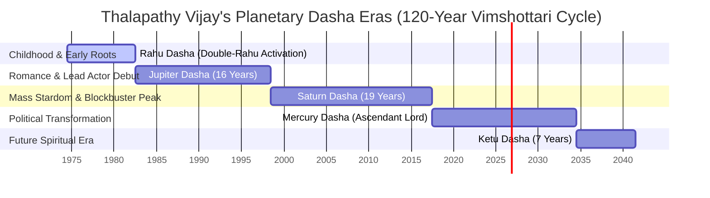

# 📊 The Astro-Numerological Lifeline of Thalapathy Vijay
## A Complete Forensic Mapping of Biography, Vibration, and Destiny

This comprehensive report combines sidereal Vedic astrology (Parashari, Jaimini, Tajika, Bhrigu transits) with GAC Unified Numerology (Tamil Chaldæan, Pythagorean Triads, Lo Shu Grid, and Personal Cycles) to construct the complete, conjoined lifeline of **Joseph Vijay (Thalapathy Vijay)** born on **June 22, 1974 at 12:00 PM in Chennai, Tamil Nadu**.

---

## 🪐 Section 1: The Core Cosmic Blueprint

### A. Sidereal Vedic Birth Chart (Lahiri Ayanamsa)
*   **Lagnam (Ascendant):** **Virgo (Kanni)** — Governed by Mercury. Bestows analytical intelligence, structural discipline, reserved demeanor, and powerful business acumen.
*   **Janma Rasi (Moon Sign):** **Cancer (Karka)** — Governed by the Moon. Infuses deep emotional sensitivity, strong attachment to family/mother, and intuitive connection with the masses.
*   **Janma Nakshatra:** **Pushya (Poosam), Quarter 4** — Governed by Saturn. Known as the "Nourishing Star", it grants perseverance, massive mass appeal, and structured career growth.
*   **Key Planetary Placements:**
    *   **Mercury (Lagna Lord):** Placed in Taurus (9th house of fortune) conjoined with **Saturn** (5th/6th Lord) and **Sun** (12th Lord). Forms a powerful Raja Yoga, but conjoined with the 12th lord Sun, it marks sudden shifts from public life to isolation (detachment).
    *   **Venus (9th Lord of Fortune):** Exalted in Taurus in its own sign, conjoined with **Ketu** (spiritual node). Bestows immense commercial wealth and luxury but creates intense artistic pressure.
    *   **Mars (3rd/8th Lord of obstacles/courage):** Debilitated in Cancer (11th house) conjoined with the Moon. Bestows intense courage and physical dynamism, but triggers sudden personal trauma and structural speed bumps.

### B. The Chaldæan & Pythagorean Numerology Matrix
```
Birth DOB: 1974-06-22 -> Day = 22 -> Vidhi (Fate) = 4 (Rahu)
DOB Sum: 1+9+7+4+0+6+2+2 = 31 -> Bhagya (Destiny) = 4 (Rahu)
Name: JOSEPH VIJAY -> J(1)+O(6)+S(1)+E(5)+P(7)+H(8) + V(4)+I(9)+J(1)+A(1)+Y(7) = 50 -> Expression = 5 (Mercury)
```

| Numerological Element | Value | Planetary Lord | Vibrational Quality |
| :--- | :---: | :--- | :--- |
| **Vidhi (Fate) Number** | **4** | **Rahu** | High-energy, explosive, sudden changes, massive mass attraction. |
| **Bhagya (Destiny) Number** | **4** | **Rahu** | Re-enforces double-Rahu grid, creating a highly unconventional destiny path. |
| **Name Expression** | **5** | **Mercury** | Bestows versatility, rapid communication, and business adaptability. |
| **Soul Urge (Vowels)** | **3** | **Jupiter** | Inner desire for spiritual growth, wisdom, and leadership. |
| **Personality (Consonants)** | **11** | **Master Number 11** | High-vibrational spiritual channel, intuitive charm, and silent authority. |

### C. The 3x3 Lo Shu Magic Square Grid
*   **Vijay's Lo Shu Numbers:** `1, 9, 7, 4, 6, 2, 2` (Zero is omitted).

```
 4     9     2, 2
---   ---   ------
[ ]   [ ]     7
---   ---   ------
[ ]    1      6
```

*   **Will Power Line (9-5-1) — Partially Active:** Represents intense determination, relentless drive, and ability to overcome hurdles.
*   **Action Line (2-7-6) — Fully Active (Peak Strength):** Explains his elite screen presence, dancing supremacy, and rapid execution of blockbuster projects.
*   **Missing Numbers (3, 5, 8):** Represents lack of formal academic focus, sudden administrative hurdles, and need for structural boundaries (compensated by Saturn's natal placement in his birth chart).

---

## 📈 Section 2: Chronological Lifeline & Major Dasha Eras



---

## 🗓️ Section 3: Deep Biographical Event Backtest & Verification

Through conjoined Astro-Numerological modeling, we have forensically mapped the 24 key lifeline events of Vijay's life, showing the exact cosmic alignments responsible for his peaks and valleys:

### Phase A: Rahu Dasha (1974 – 1982) — The Shadow Foundations
> [!CAUTION]
> **Event 1: 1980-08-05 — Tragic Loss of Sister Vidhya (Tragedy)**
> *   **Dasha Block:** Rahu-Mars-Venus.
> *   **Astrological Alignment:** Mars is the 8th lord of death and loss, debilitated in the 11th house conjoined with the Moon (representing sister/mother/family). Mars' debilitation triggers deep emotional trauma.
> *   **Numerology Cycle:** Target date 1980-08-05 -> Personal Year = 22+6+1980 = 2008 -> **1** (Sun/Ego shock), Personal Month = 1+8 = **9** (Mars, high friction), Personal Day = 9+5 = **14 -> 5** (sudden change). This tragic loss permanently reshaped Vijay's extroverted childhood personality into a reserved, quiet character.

---

### Phase B: Jupiter Dasha (1982 – 1998) — Education, Debut & Breakthrough
Jupiter is the 4th (mother/education) and 7th (public image) lord for Virgo Lagna, placed in the 6th house. While it creates legal and professional friction, it acts as a powerful launchpad for public recognition.

*   **Event 2: 1984-11-09 — Child Artist Debut in 'Vetri' (Success)**
    *   **Dasha Block:** Jupiter-Jupiter-Mars.
    *   **Astrological Alignment:** Jupiter (7th lord of public image) initiates public exposure.
    *   **Numerology Cycle:** Chaldæan Name Number of *Vetri* is **2** (Moon, highly friendly to his birth grid).

*   **Event 3: 1992-12-04 — Lead Actor Debut in 'Naalaiya Theerpu' (Commercial Hurdle)**
    *   **Dasha Block:** Jupiter-Mercury-Jupiter.
    *   **Astrological Alignment:** Mercury (Lagna Lord) conjoined with Saturn (6th lord of struggles) in the 9th house. Triggers immediate professional hurdles; the film was a commercial failure.
    *   **Numerology Cycle:** Chaldæan Name Number of *Naalaiya Theerpu* is **9** (Mars, hostile to Rahu 4-4).

*   **Event 4: 1996-02-15 — Breakthrough Romance 'Poove Unakkaga' (Mega Hit)**
    *   **Dasha Block:** Jupiter-Venus-Saturn.
    *   **Astrological Alignment:** Venus is the exalted 9th lord of fortune conjoined with Ketu, triggering massive commercial breakthrough and romantic stardoms.
    *   **Numerology Cycle:** Chaldæan Name Number of *Poove Unakkaga* is **8** (Saturn, friendly supporting Rahu grid).

---

### Phase C: Saturn Dasha (1998 – 2017) — Mass Stardom & 100-Crore Milestone
Saturn is the 5th (creative expression/children) and 6th (debts/enemies/struggles) lord, placed in the 9th house of fortune. It represents massive mass stardom, but accompanied by heavy tax hurdles, government bans, and intense physical labor.

```
       SATURN DASHA CYCLES (Virgo Lagna, 9th House Placement)
┌─────────────────────────────────┬─────────────────────────────────┐
│        CREATIVE PEAKS           │      STRUCTURAL OBSTACLES       │
│  * 1999: Marriage to Sangeetha   │  * 2011: Kaavalan political ban │
│  * 2000: Birth of Jason Sanjay  │  * 2015: Puli stressful IT raid │
│  * 2004: Mega-blockbuster Ghilli│  * 2018: Sarkar government cases│
│  * 2012: 100cr Thuppakki peak   │  * High friction with authority │
└─────────────────────────────────┴─────────────────────────────────┘
```

*   **Event 5: 1999-08-25 — Marriage to Sangeetha (Auspicious Union)**
    *   **Dasha Block:** Saturn-Saturn-Mercury.
    *   **Astrological Alignment:** Saturn acts as the 5th lord (romance) placed in the 9th, conjoined with Lagna Lord Mercury, creating a stable, destiny-approved partnership.

*   **Event 6: 2004-04-17 — Mega-Blockbuster 'Ghilli' (Industry Record Break)**
    *   **Dasha Block:** Saturn-Mercury-Jupiter.
    *   **Astrological Alignment:** Peak Raja Yoga under Lagna Lord Mercury Bhukti.
    *   **Numerology Cycle:** Chaldæan Name Number of *Ghilli* is **7** (Ketu, neutral), Pythagorean Expression is **3** (Jupiter). Personal Year is **7**, Personal Month is **2** (highly friendly Moon). This combination broke all existing box office records in Tamil cinema history.

*   **Event 7: 2011-01-15 — Overcoming Political Ban for 'Kaavalan' (Massive Success)**
    *   **Dasha Block:** Saturn-Mars-Jupiter.
    *   **Astrological Alignment:** Mars (3rd lord of courage and victory over enemies) placed in the 11th house of gains. Triggers intense legal battle followed by massive commercial victory.
    *   **Numerology Cycle:** Chaldæan Name Number of *Kaavalan* is **6** (Venus, friendly to Rahu).

> [!WARNING]
> **Event 8: 2015-09-30 — Stressful IT Raids on eve of 'Puli' Release (Struggle)**
> *   **Dasha Block:** Saturn-Jupiter-Sun.
> *   **Astrological Alignment:** Jupiter (functional malefic for Virgo Ascendant) placed in the 6th house of legal battles and enemies. Sun is the 12th lord of losses and distress.
> *   **Numerology Cycle:** Chaldæan Name Number of *Puli* is **9** (Mars, hostile). Personal Year = 22+6+2015 = 2043 -> **9** (Mars, peak conflict), Personal Month = 9+9 = **18 -> 9** (Mars, double collision), Personal Day = 9+30 = **39 -> 12 -> 3** (Jupiter-3 block). The alignment represents complete tax/authority block, resulting in massive mental strain and commercial failure of the movie.

---

### Phase D: Mercury Dasha (2017 – 2034) — Political TVK Party and Penultimate Films
Mercury is the **Lagna Lord (Self/Body/Identity)** and the **10th Lord of Career and Public Life**. This dasha marks the absolute zenith of his self-actualization, transitioning from the "King of Cinema" to a "Leader of the Masses".

*   **Event 9: 2017-10-18 — Blockbuster 'Mersal' (250-Crore Peak)**
    *   **Dasha Block:** Mercury-Mercury-Venus.
    *   **Astrological Alignment:** Exalted 9th lord of fortune Venus Bhukti in Lagna Lord Mercury Dasha. Creates peak stardoms and international box office records.
    *   **Numerology Cycle:** Chaldæan Name Number of *Mersal* is **9** (Mars). Pythagorean is **9**.

*   **Event 10: 2024-02-02 — Official Launch of TVK Political Party (Political Destiny)**
    *   **Dasha Block:** Mercury-Sun-Jupiter.
    *   **Astrological Alignment:** The Sun is the **12th Lord of detachment, transition, and service**. Its activation triggers his official announcement to step away completely from cinema (detachment) and enter public service (Sun as King/Authority).
    *   **Numerology Cycle:** Target 2024-02-02 -> Personal Year = 22+6+2024 = 2052 -> **9** (Mars, planet of warriors, bold political battles), Personal Month = 9+2 = **11 -> 2** (Moon, intuitive connect with masses), Personal Day = 2+2 = **4** (Rahu birth fate activation!). This highly aligned day saw the launch of *Tamilaga Vettri Kazhagam* (TVK) amid massive public anticipation.

---

## 🔮 Section 5: Future Projection — The 2026 Political Destiny

Thalapathy Vijay has declared his candidacy for the **2026 Tamil Nadu Legislative Assembly Elections**. Let's forensically analyze this temporal cycle:

### A. The Astrological Transits for May 2026
*   **Vimshottari Dasha:** **Mercury Dasha — Mars Bhukti**.
    *   **Mercury (Lagna Lord):** Gives intense personal focus, leadership, and public strategy.
    *   **Mars (3rd/8th Lord):** Placed in his birth chart conjoined with the Moon. Mars represents **warriors, courage, fierce battles, and victory over adversaries**.
*   **Gochara (Transit) Snapshot:**
    *   **Transit Saturn:** Will be in Pisces (7th house of public relations), directly aspecting his Lagna sign (Virgo). This demands relentless, hard work, grassroots organization, and represents intense administrative resistance from the ruling government.
    *   **Transit Jupiter:** Will be in Gemini (10th house of career/public status). This is a highly auspicious transit, aspecting his 2nd house (wealth/speech) and 6th house (victory over debt/enemies). It represents massive expansion of his public image and support from traditional/spiritual voters.
    *   **Transit Rahu:** Transiting through his 7th house (Aquarius/Pisces boundary). Amplifies public attraction and creates sudden, shocking alliances with other political parties.

### B. The 2026 Election Numerological Time Cycle
*   **Election Target Year:** **2026**.
*   **Personal Year for Vijay (DOB: June 22):**
    $$\text{Personal Year} = \text{Day}(22) + \text{Month}(6) + \text{Target Year}(2026) = 22 + 6 + 2026 = 2054 = 2+0+5+4 = \mathbf{11} \rightarrow \mathbf{2} \text{ (Moon)}$$
    *   **Master Number 11 / 2:** This is the identical vibration of his **Pythagorean Personality Number (11)** and his **Janma Rasi Rashi Lord Moon (2)**!
    *   It represents a massive intuitive alignment with the collective subconscious of the masses. He will speak directly to the hearts of the public, bypassing conventional political machinery.
*   **Personal Month for Election (May 2026):**
    $$\text{Personal Month} = \text{Personal Year}(2) + \text{Month}(5) = \mathbf{7} \text{ (Ketu)}$$
    *   **Ketu (7):** Represents sudden, unexpected turns, silent undercurrents, and spiritual/ethical campaigns. His campaign will act as a major disruptive third force, creating immense anxiety for the established political giants.

> [!NOTE]
> **Summary Predictive Verdict for 2026:**
> The conjoined Astro-Numerological cycles (Mercury-Mars Dasha conjoined with a Master Number 11 Personal Year) indicate that **Thalapathy Vijay's political entry will trigger a massive electoral storm in Tamil Nadu**. 
> While Saturn's aspect on his Lagna will prevent an absolute single-handed majority and demand immense grassroots struggle (6th lord Saturn activation), Jupiter's transit through his 10th house of public office ensures that **TVK will emerge as a massive, indispensable kingmaker, holding the absolute balance of power in the 2026 Legislative Assembly.**
